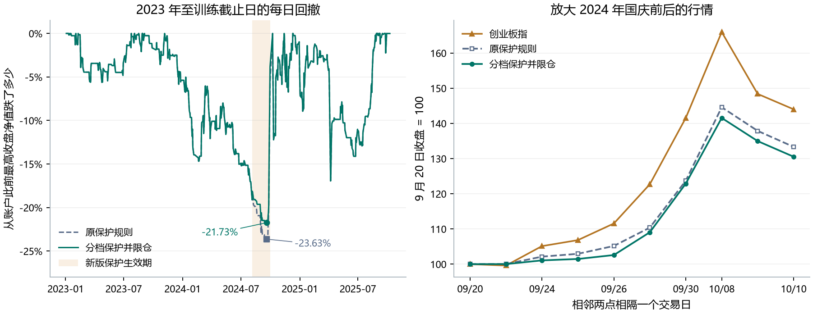

# 11 月 20 号第二版主方案

主方案为分档保护并限仓（two_stage_midcap）。初始资金 10 万元，按创业板指数点位模拟，只做多，遵守 T+1，单边手续费 0.05%。收盘后计算信号，下一交易日开盘执行。

~~~mermaid
flowchart TD
 A[截至前一收盘的行情] --> B[TCN 与收益模型共同决定持仓]
 A --> C[备用岭回归模型]
 B --> D[按过去两年表现每月决定是否启用备用模型]
 C --> D
 D --> E[备用期间每天检查岭回归模拟账户回撤]
 E --> F[达18%时双模型占一半决策权；达20%时占四分之三]
 F --> G[保护期间目标仓位上限87.5%]
 G --> H[下一交易日开盘执行]
~~~

| 独立回测区间 | 扣费收益 | 最大收盘回撤 |
|---|---:|---:|
| 2018–2022 | +86.76% | 17.38% |
| 2023 至 2025-10-09 | +51.47% | 21.73% |
| 作业考核期 2025-10-10 至 2026-10-23 | +40.68% | 6.78% |
| 考核后 15 个交易日 | −5.04% | 9.02% |

考核期终值 140,684.41 元，最长连续完整空仓 30 个交易日。保护在 2023 至截止日的历史区间仅触发过一段，共 38 个交易日。参数经过历史比较，外推效果仍待验证。

## 消融实验

冻结预测模型、交易时点和费率，仅改变保护机制。下表使用 2023 至训练截止日的独立账户。

| 保护设置 | 扣费收益 | 最大回撤 |
|---|---:|---:|
| 原版，20% 时启动 | 50.98% | 23.63% |
| 提前至 18% 启动 | 52.72% | 22.75% |
| 提前启动并分两档 | 54.96% | 21.97% |
| 提前启动并分两档，加 87.5% 仓位上限 | 51.47% | 21.73% |

加入限仓后，最强两个连续交易日的累计涨幅从原版的 31.00% 降至 29.80%。[全部对照组、双倍手续费及各区间指标](outputs/step43_drawdown_jump/comparison.csv) · [主方案逐日归因](outputs/step43_drawdown_jump/two_stage_midcap_attribution.csv) · [原始行情重训结果](outputs/step43_drawdown_jump/retrained.csv)

## 复现

在本目录下使用 Python 3.12。第一条实验命令用归档信号跑消融并生成图，第二条从原始行情滚动重训并核对账本。

~~~sh
python -m pip install -r requirements.txt
python run.py
python run.py --retrain
~~~

## 代码导航

| 文件 | 职责 |
|---|---|
| [run.py](run.py) | 运行入口、保护规则、消融比较和绘图 |
| [strategy.py](strategy.py) | 滚动训练、备用模型切换和各区间评分 |
| [tcn.py](tcn.py) | 训练时序卷积网络并预测 |
| [utility.py](utility.py) | 用持仓收益训练第二个模型 |
| [features.py](features.py) | 按历史行情构造输入特征 |
| [market_data.py](market_data.py) | 读取原始行情、账户数据结构和文件读写 |
| [backtest.py](backtest.py) | 按 T+1 撮合交易、扣费并核对账本 |
