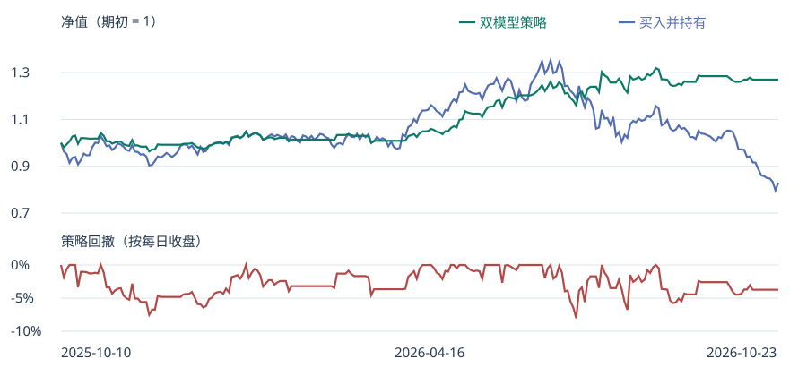

# 创业板指数增强：今天收盘判断，明天开盘交易

2026 年机器学习投资实训 · **题目一**。用 10 万元模拟买卖创业板指（399006）。每天收盘后，两个模型分别判断下一交易日是否值得持有，策略据此选择满仓、半仓或空仓。项目按正式考核区间的扣费收益整理，只展示一套方案。

[中文作业原件（Word）](docs/2026_Coursework_Chinese.docx) · [题目一要求与老师确认的规则](docs/coursework.md) · [双模型架构与训练细节](docs/architecture.md) · [逐笔交易](results/trades.csv)

## 作业区间赚了多少？

2025-10-10 至 2026-10-23，共 252 个交易日。期初和期末均以现金计价，买卖每边扣成交额的 0.05%。

| 指标 | 结果 |
|---|---:|
| 初始资金 → 期末资产 | 100,000.00 → **126,996.99 元** |
| 策略累计净收益 | **+27.00%** |
| 同期买入并持有指数（同费率） | −17.00% |
| 相对买入持有的收益差 | +43.99 个百分点（按未四舍五入的数值计算） |
| 最大回撤（按收盘资产） | **8.03%** |
| 成交笔数 / 累计费用 | 107 笔 / 4,194.20 元 |
| 最长连续开盘调仓后空仓 | 15 个交易日；2026-02-03 至 2026-03-03 |



**怎样理解这个成绩：** +27.00% 是已经比较过多种配置后，正式区间里观察到的最高回测收益，不是独立盲测。市场宽度补仓在这一年只触发了 3 天，带来的净收益增量约 0.05 个百分点；在截止日前的历史验证中，它没有通过“回撤不增加”的筛选。因此不能把这一年的微小优势解释为可重复的优势。

## 仓位怎么决定？

| 收盘后两票的结果 | 下一交易日目标仓位 |
|---|---|
| 两票都持有 | 100% |
| 两票都空仓 | 0% |
| 一票持有，且收盘高于 20 日均线 | 50% |
| 一票持有，收盘不高于均线，但成分股普遍上涨 | 50% |
| 其余情况 | 0% |

“普遍上涨”的门槛是当日上涨占比至少 60%，且最近 5 个交易日的平均占比至少 50%；每天至少有 90 只有效报价。两票都空仓时不会触发补仓。[架构图](docs/architecture.md) 展开了每一票如何产生。

## 从零复现

已用 Python 3.12、PyTorch 2.10 CPU 版复现，无需显卡、API 密钥或在线下载行情。在仓库根目录执行：

```bash
python -m venv .venv
# Windows PowerShell 激活：.\.venv\Scripts\Activate.ps1
# macOS / Linux 激活：source .venv/bin/activate
python -m pip install -r requirements.txt
python run.py
```

脚本从 [指数日线](data/SZ%23399006.txt) 和 [成分股市场宽度](data/breadth.csv) 重新训练、生成预测并回测，将结果写到 `run_output/`。提交的 [参考指标](results/metrics.json)、[每日信号](results/signals.csv)、[每日账户](results/daily.csv) 和 [成交明细](results/trades.csv) 可直接对照。一次运行还会逐笔独立核对费用、T+1 可卖份额、余额和回撤。不同计算库或硬件上的浮点结果可能略有差别。

从代码阅读：先看 [仓位决策与运行入口](run.py)，再看 [TCN](tcn.py)、[交易效用模型](utility.py)、[量价特征](features.py) 和 [交易账户](account.py)。想重画上图，运行 `python plot_results.py`（只用 Python 标准库）。
