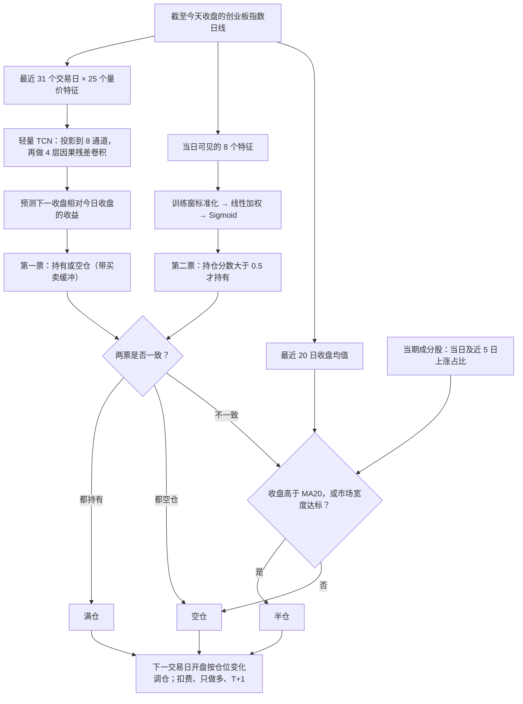

# 双模型如何从日线走到仓位

**第一票：TCN 学走势。** 输入包括多周期收益、均线距离、波动率、K 线形态、成交量与成交额相对值，以及 20 日价格位置。标准化只用本次训练窗。四层卷积核宽度为 3，膨胀率依次为 1、2、4、8，只向过去取值。最后一个时间步输出次日收盘收益预测，可换算为预测点位。预测严格高于 +0.10% 时持有，小于等于 0 时空仓，中间沿用上一票；首日以前为空仓。固定种子 2026，AdamW、Huber 损失、12 轮、批量 128。

**第二票：交易效用模型学何时值得持有。** 它看 1、5、20 日收益，60 日均线距离、20 日波动、K 线实体、20 日相对成交额和 20 日价格位置。目标是提高下一开盘至再下一开盘的平均对数增长，同时惩罚换手成本和过大的参数。Sigmoid 输出的是仓位分数，不是上涨概率。两票的训练目标不同，所以它们可以对同一天给出不同意见。

**什么时间能知道什么？** 每个模型使用最近 1,260 个标签已揭晓的样本，每 20 个交易日重新拟合一次。第一笔交易是 2025-10-10，首次训练最晚可用信息为 10 月 9 日，且交易效用标签必须等到区间末端的开盘价已公布。市场宽度按生效日期使用当时的成分股（国证成分调整信息与东方财富行情汇总），不拿期末名单倒推历史。

**怎样成交？** 目标仓位改变才在下一开盘调仓，持有期间仓位可随价格漂移。无法取得合格的宽度数据就不触发宽度补仓。最后一个交易日禁止加仓，收盘清算。账户可持有小数份额，未模拟真实基金跟踪误差、滑点或冲击成本。

**模型效果与策略效果分开看。** 正式期 TCN 次日方向准确率 53.17%，预测收盘点位平均绝对误差 58.16 点。策略净收益还取决于第二票、仓位、交易时点和费用，所以不能用方向准确率直接推算收益。
